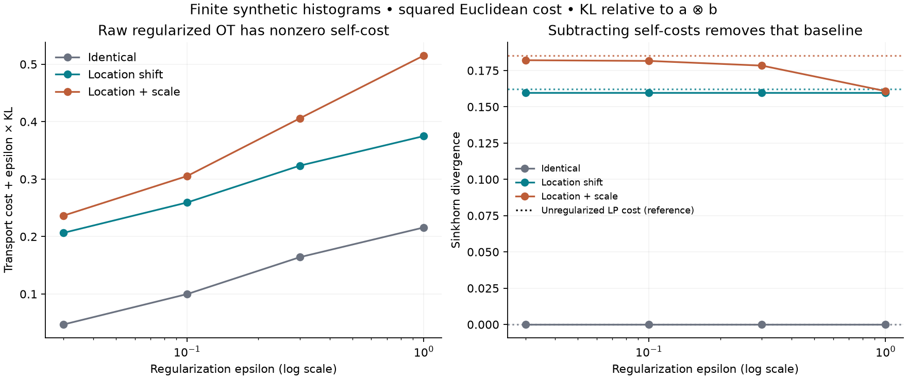
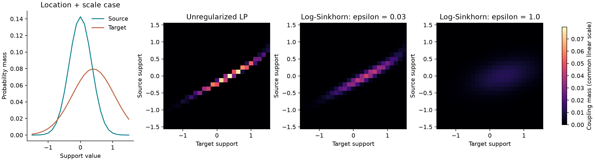

# Sinkhorn Transport Diagnostics

An original, small numerical-optimization portfolio project about comparing
finite probability distributions. It implements log-domain entropic optimal
transport, feasible-plan rounding, primal/dual diagnostics, an unregularized
linear-programming reference, and Sinkhorn self-cost correction.

The experiments use **deterministic synthetic histograms**, not personal,
financial, or externally collected data. Standard mathematical methods are
attributed below; the code and experiment design are original.

## Run locally

Python 3.11 or newer:

```bash
python3 -m venv .venv
source .venv/bin/activate
python -m pip install '.[test]'
python -m pytest -W error
transport-audit --output artifacts
```

The command writes JSON diagnostics, selected coupling matrices, and two PNG
figures. It makes no network requests. The default experiment has 25 support
points and 12 distribution/regularization combinations. `--bins 9` runs a smaller
smoke test. A clean checkout can regenerate everything in `artifacts/`.

For the committed run's Python 3.13 dependency versions, install with
`python -m pip install -c constraints-py313.txt '.[test]'` instead. The regular
installation and CI use supported version ranges. JSON outputs are deterministic
in the same environment; small floating-point differences across platforms or
dependency versions are expected.

## Reproduced results

The committed default run completed **38 transport solves**. The table shows
raw self-cost and the location-plus-scale case; the latter's unregularized LP
cost was **0.185319**. Values below are rounded; full precision and all cases are
in [summary.json](artifacts/summary.json).

| Epsilon | Identical: raw OT | Location + scale: raw OT | Location + scale: divergence |
| --- | ---: | ---: | ---: |
| 0.03 | 0.046958 | 0.236491 | 0.182097 |
| 0.10 | 0.099882 | 0.305411 | 0.181606 |
| 0.30 | 0.164228 | 0.406026 | 0.178389 |
| 1.00 | 0.215795 | 0.515133 | 0.160826 |

For identical inputs the corrected divergence was zero at all four settings.
For unequal shapes it still changes with epsilon: subtracting self-costs does
not turn regularized OT into the unregularized answer.





Maximum raw marginal error was 8.61e-12; after rounding it was 1.11e-16.
The largest primal/dual gap was 9.06e-11 and no solve needed more than 420
iterations. The smallest gap was -2.22e-16, consistent with floating-point
roundoff, and is kept in the output rather than clipped. At this scale,
nominal bracket endpoints may also reverse by a few units of roundoff.

In the +1000 cost-offset stress, **100%** of naive kernel entries became zero.
The log-domain solver's maximum coupling change was **1.09e-14** (rounded up),
and its computed objective shift differed from 1000 by **0.0** in this run.
Subtracting a known constant before exponentiating would also fix this
particular kernel example; log-domain updates address the more general scaling
calculation. Neither observation is a speed benchmark.

The test suite contains **59 cases**, including analytic solutions, independent
scalar optimization, LP/quantile agreement, symmetry, translation and cost-offset
invariance, rounding, invalid inputs, explicit nonconvergence, deterministic
replication, and an end-to-end CLI run. CI repeats tests and the default example
on Python 3.11 and 3.13.

## Mathematical convention

For positive probability vectors a and b, nonnegative cost matrix C, and
epsilon > 0, this project solves

```text
OT_epsilon(a,b) = min_P <C,P> + epsilon KL(P || a outer b)
subject to P >= 0, P 1 = a, P.T 1 = b.
KL(P || Q) = sum_ij [P_ij log(P_ij/Q_ij) - P_ij + Q_ij].
```

The generalized-KL convention matters: using raw negative entropy changes
objective values by marginal-dependent constants, although not the optimal
coupling for fixed marginals. We report the transport component, KL penalty,
and total objective separately. The unregularized reference is the squared
2-Wasserstein cost on these discrete supports, **not its square root**.

The dual objective and implied plan are

```text
L(f,g) = a.f + b.g - epsilon [sum_ij a_i b_j exp((f_i+g_j-C_ij)/epsilon) - 1]
P_ij   = a_i b_j exp((f_i+g_j-C_ij)/epsilon).
```

Alternating updates use `logsumexp`; a weighted gauge shift prevents needless
potential drift. No uncentered exponential kernel is formed during optimization.
Every ten iterations we check both marginal residuals. Before computing the
primal objective we scale rows down, then columns down, then add a rank-one
deficit correction. This rounding step is important: evaluating the objective
on an infeasible iterate does not give a valid primal upper bound.

The solver returns only when the raw maximum absolute marginal error is <=1e-11
and the rounded primal-minus-dual gap is <=1e-9. Rounding separately checks a
1e-13 marginal tolerance. Small negative gaps due to float64 roundoff are retained;
materially negative gaps raise an error. Failure to converge raises an exception.
Primal/dual brackets are numerical diagnostics, **not rigorous interval-arithmetic
certificates**. Absolute marginal error does not ensure small relative error in
extremely low-mass bins.

## What the experiment checks

1. **Self-cost:** regularized OT between a distribution and itself generally is
   not zero. The Sinkhorn divergence subtracts half of each self-cost:
   `S = OT(a,b) - 0.5 OT(a,a) - 0.5 OT(b,b)`.
2. **Regularization effects:** compare identical, location-shifted, and
   location-plus-scale histograms across epsilon = 0.03, 0.1, 0.3, 1.0. All use
   25 equally spaced points in [-1.5, 1.5]. Masses are proportional to
   `exp(-0.5*((x-center)/width)^2)`. Source: center 0, width 0.35. Targets:
   (0, 0.35), (0.4, 0.35), (0.4, 0.65). These are normalized finite histograms,
   not exact continuous Gaussian distributions; boundary truncation matters.
3. **Independent baseline:** SciPy/HiGHS solves the unregularized transportation
   LP; tests also check it against one-dimensional quantile matching and a
   hand-solvable 2-by-2 problem. "LP reference" does not mean symbolic exactness.
4. **Underflow stress:** adding 1000 to every cost at epsilon=0.1 makes the
   naive, uncentered `exp(-C/epsilon)` kernel all zeros. It must not change the
   optimal coupling, and must increase the regularized objective by exactly
   1000 in exact arithmetic. This is a numerical invariance test, not a new dataset.

For each divergence, three separate lower/upper objective estimates propagate
to `[L_ab - (U_aa+U_bb)/2, U_ab - (L_aa+L_bb)/2]`. This brackets the regularized
divergence up to numerical error, not the unregularized transport cost.

## Scope and limitations

- Dense CPU implementation, O(nm) memory/work per iteration; not a production
  OT library, performance benchmark, GPU solver, or differentiable training loss.
- Balanced, finite, strictly positive weights only; remove zero-weight support
  points first. Weight sums must be within 1e-12 of one, then are normalized.
  Negative costs, nonfinite values, and invalid parameters are rejected.
- Log-domain updates help with kernel underflow but do not make arbitrary
  cost scales, tiny regularization, or extreme weights numerically safe.
  No epsilon scaling, acceleration, sparse approximation, or unbalanced OT.
  In development, the self-transport problem on [-1, 0, 1] with weights
  [0.2, 0.5, 0.3] and epsilon=0.1 still had a 1.57e-6 marginal residual
  after 10,000 steps, so the solver correctly refused it. Three such difficult
  cases are retained as explicit nonconvergence regression tests with a shorter
  1,000-step budget; correctness tests also cover well-conditioned cases.
- A divergence is not automatically a metric; no triangle-inequality claim.
  Self-cost correction does not remove all regularization effects or choose
  the appropriate epsilon for a downstream application.
- No distribution-shift hypothesis test, statistical confidence interval,
  predictive performance claim, or real-world research conclusion is made.

## References

- [Cuturi (2013), Sinkhorn Distances](https://arxiv.org/abs/1306.0895): entropic
  regularization and matrix scaling.
- [Altschuler, Weed & Rigollet (2017), Near-linear time approximation algorithms](https://arxiv.org/abs/1705.09634):
  Algorithm 2 is the mathematical source for feasible-plan rounding.
- [Feydy et al. (2019), Interpolating between Optimal Transport and MMD using Sinkhorn Divergences](https://proceedings.mlr.press/v89/feydy19a.html):
  the self-cost-corrected divergence.
- SciPy documentation: [logsumexp](https://docs.scipy.org/doc/scipy/reference/generated/scipy.special.logsumexp.html)
  and [linprog](https://docs.scipy.org/doc/scipy/reference/generated/scipy.optimize.linprog.html).

MIT licensed. This is an educational implementation of established methods,
not a claim of a new algorithm or an affiliation with the cited authors.
